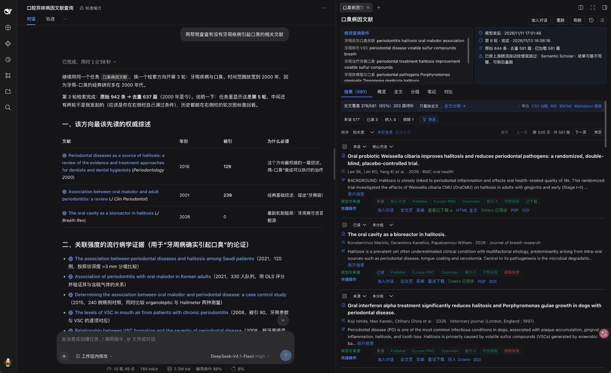

# dsh-plugin-litsearch

DeepSeek Harness 文献检索插件：模型主导检索，界面可视化呈现检索过程与结果。



*左：模型在对话里完成检索、给出改进建议；右：右侧栏同步列出命中文献、全文状态，以及「加入对话 / 下载 / 存 Zotero」等逐篇操作。*

**让 AI 的对话和右侧栏面板一起查文献 —— 说一句话，界面就动；点一下，AI 就接上。**

不用注册账号、不用申请密钥、不用另起服务。**搜索、下载全文、存入 Zotero，对话里说和界面上点走的是同一套流程**：模型把范围算准，右侧栏弹出结果、清单和逐篇进度；面板的当前任务、当前页、筛选与勾选，模型也读得到。两边共用同一份任务现场，不用复制 id、不用猜对方看到哪一页。

> 当前版本 **v0.4.1** · 十个免费来源（PubMed / Europe PMC / OpenAlex / Crossref / Semantic Scholar / arXiv / PubTator / DOAJ / OpenReview / OpenAIRE）+ 可选谷歌学术（需自备 SerpAPI Key，默认关闭）。

## 为什么做这个

文献检索插件、MCP、Skill 早已不缺，DeepSeek Harness 平台上也是一大堆。但它们基本只在对话框里工作：结果靠模型输出的一段文字或 Markdown 摘要交代，**检索过程中看不到结果列表，也点不开具体那篇文献** —— 想改条件、核对命中、挑出某几篇，只能反复追问模型。

我想要的不是再做一个「会查文献的模型」，而是**让对话与右侧窗体成为一次操作的两个面**：模型负责理解和指挥，界面负责看得见、点得着，检索中随时能看结果、点开原文、接着筛，毫无割裂感。DeepSeek Harness 的「一切皆插件」让两侧共用同一份任务现场成为可能 —— 别的平台很难做到，这里正好是现成的实现路径。

## 模型 × 界面：一套操作，两个入口

核心不是「AI 能查」加「面板也能查」，而是**两者绑在同一个现场**。

| 动作 | 在对话里说一句 | 在右侧栏点一下 | 两边怎么合上 |
| --- | --- | --- | --- |
| **搜索** | 「查 GLP-1 与心血管结局，只看 2020 年后的」 | 填检索式、选来源 / 年份 / 排序 | 模型发起的检索落到同一个任务 tab，面板自动打开刷新；界面改条件重跑也记成新一轮，模型 `literature_task current` 读得到完整条件 |
| **下载全文** | 「下载第 2 页有 PDF 的」「下载当前全部」 | 勾选 → 批量下载 | 模型把范围算成已校验的 `paperId` 清单，面板自动弹出下载框逐篇跑进度；「当前页 / 第 N 页 / 当前筛选」以面板上报的视图快照为准 |
| **存入 Zotero** | 「把这批存到『综述』目录」 | 勾选 → 存入 Zotero → 选目录 | 与下载共用同一套范围解析；目录唯一匹配时自动预选开跑，没点名就停在弹窗等你选 |

反方向：面板点「加入对话」，论文或整个任务变成输入框里的胶囊，AI 拿到完整信息接着读。**决定权始终在你手上** —— 不自动发送、不自动再搜一轮；批量操作有独立取消按钮（关闭弹窗只隐藏，后台仍会跑完）；目录有歧义时模型一律先问，绝不猜。

## 第一次用，三步就够

1. **在对话里告诉 AI 要查什么**，比如「帮我查 GLP-1 与心血管结局的文献，只看 2020 年以后的」。模型发起检索、建好任务，右侧栏默认自动打开任务页接结果。
2. 结果按来源列出，每篇有标题、作者、年份、被引次数和「能不能免费下全文」；想收窄就接着在对话里说，或直接在面板改条件、点筛选排序。
3. 看到有用的点「加入对话」让 AI 总结比较；也可以接着说「下载第 2 页有 PDF 的」「把这批存到综述目录」，面板弹出对应操作。

也能自己在界面上开头，同样落成任务；但**最省事的是让模型主导查询开始**，条件、轮次和后续操作它一路跟着。

## 能做什么

| 方面 | 能力 |
| --- | --- |
| 检索 | 多条检索式自动去重；来源 / 年份 / 语言 / 类型 / 只看 OA / 排序当场可调；字段标签与 AND / OR 语法提示；单源限流排队、抖动重试 |
| 任务 | 一主题一任务，改条件重跑并记下每轮时间、条件、发起方、命中数；筛读状态跨轮保留；「加入对话」带任务进新会话续接 |
| 结果 | 概览环形图 / 折线 / 双色条可点选筛选；多条件过滤、每页 20 条；独立论文页含摘要与全文链接，有 PMID 的可看 PubTator 实体；「全文」页列整批台账 |
| 筛读与批量 | 没读 / 读过 / 纳入 / 排除、研究分组与分组阅读清单、与旧任务对比整批纳入「新增」、本页全选跨页累加、批量改状态 / 分组 / 下载 / 存 Zotero / 导出；下载与同步 5 并发、逐篇进度 |
| 全文 | PDF 预览下载到工作目录 `dsh-litsearch/`；候选按「OA 直链 → 未确认直链 → 仓储渲染页」排序，缺直链时并发反查 OpenAlex / Europe PMC / OpenAIRE；抓取按域限并发、429 冷却、`%PDF-` + `%%EOF` 双校验、`.part` 原子落盘；PMC 用 Europe PMC HTML 兜底，arXiv 用 HTML 全文兜底；导出 CSV / RIS / BibTeX / Markdown |
| 对话 | 加入对话胶囊、任务续接、一句话批量下载 / 存 Zotero（含按页取数与只读预演） |

**能力边界**：PDF 由 Host 后台直连抓取，没有浏览器会话和机构授权，订阅 / 登录 / 人机验证页拿不到，403 / 限流 / HTML 页 / 无候选分别给原因，浏览器打开卡片上的 PDF / DOI 手动另存即可；填联系邮箱启用 Unpaywall 补 OA 候选，但补出的出版商直链仍可能被拒。

## 对话里的范围怎么算

| 你可以这么说 | 实际范围 |
| --- | --- |
| 「下载这几篇」 | 指定文献（结果里给出的 `paperId`） |
| 「下载当前页的所有 PDF」 | 右侧栏当前这一页，且仅有 PDF 直链或已下载 |
| 「下载第 4–5 页」「把第二页有 PDF 的存到 Zotero」 | 面板第 4–5 页 / 第 2 页，页内再筛（每页固定 20 条） |
| 「下载『综述』分组」「2023 年后、开放获取、已纳入的」 | 分组跨页全量 / 条件筛选 |
| 「下载当前全部文献」 | 当前筛选下的全部结果（跨页）；说「整个任务」才下全任务 |

- 模型不翻页、也不搬 id：页码交给服务端按视图快照切片，`pageBase='view'` 是「第 2 页里有 PDF 的」，`filtered` 是「有 PDF 的第 2 页」；越界直接拒绝并给出总页数。
- 拿不准先用只读 `literature_scope` 预演（返回命中数、总页数、面板视图、前 10 篇，不产生指令）；每个 `paperId` 逐一与任务结果校验，编造的会被忽略；面板没打开或快照过期会提示先打开任务页。
- 下载与 Zotero 共用 `resolveModelScope()`，7 种 `scope` 一套口径；`hasPdf` 与 `openAccessOnly` 不混用，付费墙不会静默算成功。指令按 `commandId` 幂等排队、串行执行；不设篇数上限，大范围建议先收窄。**升级后需重启宿主或重新加载插件**才生效。

## 搜索任务与轮次

**一个主题 = 一个任务 = 一个 tab，一个对话只跟一个任务**；不满意就在同一任务里改条件重搜一轮，而不是新开任务。

- 模型首次检索建任务并用 `title` 命名，后续默认复用「当前任务」；`current` 读当前任务（没有时明确回「当前没有任务」），`get` 可按筛读 / 分组 / 年份 / 来源 / 全文状态过滤，`fields=ids` 回紧凑清单（最多 200 条 + `offset`），并回显「第 x/y 页｜每页 20 条｜筛选…」。
- 每轮记一条 `SearchRound`（只记元数据，最多 30 轮），时间轴 / `literature_task rounds` / `GET /tasks/:id/rounds` 可读；切换任务原位替换 tab，「当前任务」持久化、重启后恢复。
- **每轮结束模型只给改进建议，不自行发起下一轮**；你重跑或明确要求才继续。

## 安装

要求 dsh `>=0.2.1-rc.3 <0.3.0-0`，包内是预构建产物（`lib/` + `client/client.js`），安装不跑构建：

```sh
dsh plugin --profile <profile> add dsh-plugin-litsearch
```

## 配置

插件页 → `dsh-plugin-litsearch` → 配置，保存即生效；界面按数据源分组，密钥不回显。

| 字段 | 说明 | 默认 |
| --- | --- | --- |
| `contactEmail` | 联系邮箱（polite pool）；**填写后启用 Unpaywall** 按 DOI 补 OA 候选，补出的直链仍可能被拒 | 空 |
| `ncbiApiKey` / `s2ApiKey` / `serpApiKey` | 提升 PubMed / S2 额度；`serpApiKey` 启用谷歌学术（每月 250 次免费），留空则该源不可选 | 空 |
| `pubmedIntervalMs` / `s2IntervalMs` / `arxivIntervalMs` | 各源最小请求间隔（毫秒） | 350 / 3000 / 3000 |
| `defaultPageSize` / `requestTimeoutMs` | 每源条数 / 超时（Europe PMC 另有 25s 下限） | 20 / 20000 |
| `defaultSources` / `defaultSort` / `defaultLanguage` | 新任务默认来源、排序、语言（至少留一个来源） | 七源 / 相关度 / 不限 |
| `autoOpenTaskTab` / `maxTaskTabs` | 模型发起后自动打开 tab；后者为兜底上限 | 开 / 5 |
| `taskRetentionDays` / `taskRetentionCount` / `taskMaxPapers` | 未保留任务的天数、条数、单任务结果上限 | 90 / 120 / 1500 |
| `pdfRoot` / `pdfMaxMb` / `autoDownloadPdf` / `pdfCacheMaxMb` | PDF 目录、单文件上限、检索后自动下载、去重缓存上限（0 关闭清理） | 工作目录 / 30 / 关 / 512 |
| `enableEpmcFulltext` / `zoteroEnabled` / `zoteroBaseUrl` | PMC HTML 兜底 / 同步开关 / connector 地址（仅回环） | 开 / 开 / `http://127.0.0.1:23119` |
| `zoteroAttachPdf` / `zoteroTag` | 附带 PDF / 附加标签 | 开 / `dsh-litsearch` |

设置页另有逐源探活与限流冷却、PDF 目录可写性、Zotero 连接测试，以及按任务 / PDF 缓存 / 全部清理文件。

## 数据目录

本地 JSON，不依赖数据库：

```
$DSH_HOME/storages/dsh-plugin-litsearch/
├── tasks/index.json + <taskId>.json   # 任务索引与全量元数据（条件、轮次、结果、分组、筛读）
├── current.json                       # 当前任务绑定
├── out/<taskId>/                      # CSV / RIS / BibTeX / Markdown 导出
└── pdfs/<sha256>.pdf                  # PDF 去重缓存（受 pdfCacheMaxMb 约束）
```

`DSH_HOME` 由宿主注入（未设置回落 `~/.dsh`）；旧版 `~/.dsh/dsh-litsearch/` 首次启动复制迁移、原目录留作备份。**可读 PDF 不在这里**，由 `pdfRoot` 决定（默认工作目录下的 `dsh-litsearch/`）；视图快照与模型指令只存内存（30 / 10 分钟窗口），不落盘、重启归零。

## Zotero 同步

走桌面端自带 connector，不需要 Web API Key：启动 Zotero → 勾选文献点「存入 Zotero」→ 弹窗选目录再同步。目录列表来自本机 Zotero，标出当前选中与不可写附件的目录，不必事先选分类。5 并发逐篇显示状态、可取消（已发出的仍会完成），写入元数据、分组标签与可选 PDF 附件；目录只读时只存条目，失败保留本次条目的 RIS 导出备用。**重新同步新建条目，不覆盖、不跳过已同步文献。**

## 隐私

- 检索词发给所选数据源的公开 API；谷歌学术（默认关闭）经第三方 SerpAPI 转发；填了 `contactEmail` 才用 DOI + 邮箱查 Unpaywall。
- PDF 下载与 Zotero connector 只在本机（connector 仅回环）；视图快照与模型指令只在内存。API Key 存本机配置文件（明文），不回显、不写日志。

## 本地开发

```bash
pnpm install
pnpm build && pnpm build:client   # src -> lib；src/client -> client/client.js
pnpm typecheck:client
pnpm test                         # node:test 单元测试
```

专项单测见 `test/download-scope.test.ts`、`download-events.test.ts`、`download-store.test.ts`、`zotero-command.test.ts`（范围解析、按页切分、事件增量、指令幂等、目录歧义）。独立 profile 调试：`dsh --profile litsearch`。

## 架构

- `src/search/`：检索层；`providers/` 每家 API 一个 provider，新增源实现 `Provider` 并注册。
- `src/host/`：API 端点、任务执行 / 持久化 / 统计 / 导出，及 7 个模型工具（`literature_search` / `literature_sources` / `literature_task` / `literature_scope` / `literature_export` / `literature_download` / `literature_zotero`）。
- `src/host/tasks/download.ts` + `tools.ts`：7 种 `scope`（含 `pages`）解析成已校验的 `paperId` 清单，下载与 Zotero 共用 `resolveModelScope()`；`pdf/` 管候选链与失败归类，`zotero/match.ts` 做目录唯一匹配。
- `src/client/`：任务 tab、论文页、设置页；`DownloadDialog.tsx` / `ZoteroSyncDialog.tsx` 批量弹窗，两个 `*CommandStore.ts` 各自幂等排队。

两侧靠 `/events` 增量轮询联动（Host 无原生推送）：

```text
POST /view（上报当前页 / 筛选）→ Host 存内存快照
  → 模型调 literature_download / literature_zotero，读快照算出 paperId 清单（Zotero 目录歧义不下发）
  → GET /events?sinceRev=… 拿 downloads[] / zotero[] → store 去重排队 → TaskPane → 批量弹窗
```

两个工具都会 `focusTask` 拉起 tab；快照、指令、事件日志都在内存，重启归零、不重放历史指令。

## 路线图

- [ ] DOAJ

## License

MIT
